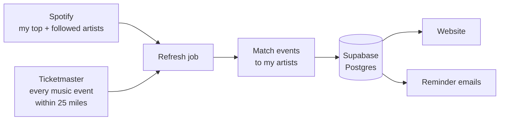

# concert-drops

A personal radar for concert ticket drops. It reads my Spotify listening, finds every upcoming presale and general on-sale for those artists near my city, ranks them by how much I'd want to be there, and keeps a schedule of the drops I'm going for, with reminder emails before each one opens.

**Live site: [concert-drops.vercel.app](https://concert-drops.vercel.app)**

I kept missing presales for artists I really like and ending up on overpriced resale. This is the fix. Visitors can try it too: a short taste quiz finds the drops that fit _their_ taste.

## Contents

- [Features](#features)
- [How it works](#how-it-works)
- [Owner and visitors](#owner-and-visitors)
- [Tech stack](#tech-stack)
- [Project structure](#project-structure)
- [Database](#database)
- [Running it yourself](#running-it-yourself)
- [Testing and CI](#testing-and-ci)
- [Limits and trade-offs](#limits-and-trade-offs)
- [Ideas for later](#ideas-for-later)

## Features

**Upcoming drops.** Every presale and general on-sale for my artists within 25 miles of the current city, one card per show. Each card has a big date tile for the next sale window (pink for presales, lime for on-sales), the venue and show date, every sale window for that show, and links to sign up or buy. Sort by **Soonest** or **Best match**.

**Match scores.** Each show gets a 0–100 score from how high its artists sit in my Spotify listening (see [Match scores](#match-scores)). Strong matches get a "Top match" or "Strong match" badge.

**On sale now.** Shows by my artists that already have tickets out, so nothing gets missed just because the presale already happened.

**My drop schedule.** I tick the drops I'm actually going for. They collect in a side panel in date order, with ticket and sign-up links.

**Countdown.** A strip at the top counts down (days, hours, minutes, seconds) to the next drop on the schedule, then shows "Open now" with a ticket button for an hour after it opens.

**Add to calendar.** Any ticked drop, or the whole schedule, downloads as an `.ics` file for Apple, Google or Outlook Calendar.

**Email reminders.** For every ticked drop I get an email at 9 PM the night before and at 7 AM the morning of (Pacific time), with the sign-up and ticket links.

**Any city.** San Francisco by default. As the owner I can search any city in the world; its shows load in under a minute and the site switches over.

**Taste quiz for visitors.** "02 Try your taste" asks eight quick questions about well-known artists, then shows the real upcoming drops in the city that fit the visitor's answers, using the same cards. No login, and nothing about visitors is stored.

**Time zones done right.** Concert times show in the venue's time zone (a show is at 8 PM where it happens). Drop times show in the _viewer's_ time zone, because that's when they need to be at their keyboard.

## How it works

### The daily refresh

Once a day a scheduled job (Vercel Cron, 13:00 UTC) rebuilds everything:



1. **Update my artists from Spotify.** My top artists over the last 4 weeks, 6 months and year (50 each) plus everyone I follow, about 725 artists. If my Spotify login has expired, the refresh carries on with the artists it already has.
2. **Sweep the city on Ticketmaster.** Instead of searching artist by artist (725 searches a day would blow through the free API limit), it downloads _every_ music event within 25 miles for the next 400 days in a handful of requests (about 850 events for San Francisco). Ticketmaster only pages through 1,000 results per search, so big searches are split into date ranges.
3. **Match events to my artists.** A Ticketmaster act matches one of my artists by Spotify ID when Ticketmaster links one, otherwise by exact name, but only if that name belongs to exactly one of my artists. Ambiguous names are skipped rather than guessed.
4. **Save.** All events in the city are saved, flagged by whether they include my artists. The homepage shows only mine; the quiz searches all of them. Each event's presales and on-sales are saved as "sale windows". Rescheduled duplicates are cleaned up, and events that disappear from Ticketmaster are removed (unless I've ticked them).
5. **Refresh the site.** The pages are cached for speed; the refresh clears that cache so new drops appear right away.

Each run is logged in the `refresh_runs` table with counts and timing.

### What counts as a "drop"

A drop is a sale window that opens in the future, or opened within the last 24 hours (so a drop that opened this morning doesn't vanish before I've seen it). Shows whose sales are all past move to "On sale now".

### Match scores

How much I like an artist, 0–100, from my Spotify lists:

| Signal                     | Up to     |
| -------------------------- | --------- |
| Top artists, last 4 weeks  | 35 points |
| Top artists, last 6 months | 35 points |
| Top artists, last year     | 20 points |
| I follow them              | 10 points |

Rank matters: #1 in a list earns its full points, #50 earns 1/50 of them. A show scores as high as its best artist. 60 or more is a **Top match**, 30 or more a **Strong match**.

### The taste quiz

The quiz has to be answerable by anyone, so it asks about well-known artists rather than whoever is playing the city this month (most of whom are small).

- **Eight questions, one per screen:** three "You're on aux. Which playlist goes on?" (two playlists of four artists each), three "Say these two play the same night. Where are you?", one "Where do you like to see live music?" (small club, theater or arena, with a real local venue as an example), and a final "Anything else you'd go see?" where any styles can be picked.
- **136 well-known artists** across nine styles: pop, indie, rock, hip-hop and R&B, electronic, folk and country, jazz and soul, classical, and Latin and world. The quiz changes daily, and every style comes up every day. The list lives in [`scripts/famous-artists.mjs`](scripts/famous-artists.mjs), which looks each name up on Ticketmaster and saves their photo.
- **If an artist in the quiz has a show coming up in the city**, their card says so ("Playing The Fillmore · Nov 12"), and picking them puts that show at the top of the results.

The answers become a taste profile (how often each style was picked, the preferred room size, any artists picked) that lives entirely in the results link, so results can be shared and nothing is saved. Every show in the city is then scored against it:

| Signal                                             | Up to     |
| -------------------------------------------------- | --------- |
| Style, scaled by how often it was picked           | 60 points |
| Room size matches (10 for one size off or unknown) | 25 points |
| Show includes an artist they picked                | 40 points |

A show's style comes from Ticketmaster's genre and subgenre, mapped into the nine styles. Room size comes from real capacities for about 40 Bay Area venues, or from the venue name elsewhere ("Arena" is big, "Club" is small). Results list shows scoring 30 or more, best matches first.

### Reminder emails

Vercel's free plan only runs scheduled jobs once a day each, at a fixed UTC hour, and Pacific time shifts by an hour twice a year. So the reminder job is scheduled at **two** UTC hours for each send time (04:00 and 05:00 UTC for 9 PM, 14:00 and 15:00 UTC for 7 AM) and only sends when it's actually 9 PM or 7 AM in Los Angeles.

Scheduled jobs can occasionally run twice. Before sending, each reminder is recorded in `reminder_sends`; a drop that already has a record for that slot is skipped, so nobody gets the same email twice. If the email fails to send, the record is removed so the next run tries again.

Emails go through [Resend](https://resend.com). Visiting `/api/cron/reminders?test=1` (with the cron secret) sends a sample with the next three drops.

## Owner and visitors

The site is public: anyone can see the drops, the schedule and the quiz. Only I can change things.

- **Login is Spotify, and only my account is let in.** The "Owner login" button signs in with Spotify through Supabase Auth. If the Spotify account isn't the owner's (`OWNER_SPOTIFY_ID`), the login is refused and the account is deleted right away.
- **The database enforces it, not just the buttons.** Every table has row-level security: anyone can read, but only the owner (checked by an `is_owner()` database function) can tick drops or change the city. Tables like Spotify tokens and reminder records aren't readable from the browser at all.
- **Owner-only controls:** ticking drops, switching cities. Visitors see the same page with a colored dot where the tick box would be.
- **Secrets stay on the server.** API keys live only in Vercel's environment settings and a local `.env.local` that's never committed.

## Tech stack

|                            |                                                                                                        |
| -------------------------- | ------------------------------------------------------------------------------------------------------ |
| Framework                  | [Next.js 16](https://nextjs.org) (App Router, Cache Components) with TypeScript                        |
| Styling                    | [Tailwind CSS 4](https://tailwindcss.com), Inter Tight                                                 |
| Database and auth          | [Supabase](https://supabase.com) (Postgres, row-level security, Spotify login)                         |
| Music data                 | [Spotify Web API](https://developer.spotify.com/documentation/web-api) (top and followed artists)      |
| Concert data               | [Ticketmaster Discovery API](https://developer.ticketmaster.com) (events, sale windows, artist photos) |
| City search                | [Open-Meteo geocoding](https://open-meteo.com/en/docs/geocoding-api) (free, no key)                    |
| Email                      | [Resend](https://resend.com)                                                                           |
| Hosting and scheduled jobs | [Vercel](https://vercel.com) (Hobby plan, Vercel Cron)                                                 |
| Tests and CI               | [Vitest](https://vitest.dev), GitHub Actions                                                           |

Everything runs on free plans with no credit card.

## Project structure

```
src/
  app/                    Pages and routes
    page.tsx              Homepage: drops, schedule, on sale now
    quiz/                 Taste quiz and its results page
    calendar.ics/         Calendar download
    auth/                 Spotify login, callback, logout
    api/cron/refresh/     Daily refresh job
    api/cron/reminders/   Reminder email job
    actions.ts            Tick a drop, switch city (owner only)
  components/             Cards, schedule panel, countdown, quiz screens…
  lib/
    spotify/              Spotify client and artist sync
    ticketmaster/         Ticketmaster client and data cleanup
    refresh/              The daily refresh: sweep, match, save
    match/                Match scores from Spotify listening
    drops/                Group sale windows into show cards
    schedule/             The drop schedule and countdown
    calendar/             .ics file builder
    cities/               City search and switching
    reminders/            When to send what, and the email itself
    email/                Resend client
    taste/                Quiz: styles, venue sizes, questions, scoring
    supabase/             Database clients and generated types
scripts/
  famous-artists.mjs      Rebuilds the quiz's artist list and photos
supabase/migrations/      Database schema, one SQL file per change
```

## Database

Postgres on Supabase. The schema lives in [`supabase/migrations`](supabase/migrations).

| Table                 | Holds                                                                                          |
| --------------------- | ---------------------------------------------------------------------------------------------- |
| `cities`              | Cities the site has loaded: location, radius, time zone, last refresh                          |
| `settings`            | The current city (one row)                                                                     |
| `artists`             | My Spotify artists                                                                             |
| `artist_affinity`     | Where each artist ranks in my Spotify lists, used for match scores                             |
| `venues`              | Venues, with city and time zone                                                                |
| `events`              | Every upcoming show in the city: date, status, genre, photo, lineup, whether it has my artists |
| `event_artists`       | Which of my artists play which show                                                            |
| `sale_windows`        | Each presale and on-sale: name, start and end, sign-up link                                    |
| `schedule_items`      | The drops I've ticked                                                                          |
| `reminder_sends`      | Which reminders have gone out, so none is sent twice                                           |
| `spotify_credentials` | My Spotify refresh token, for the daily refresh (server only)                                  |
| `refresh_runs`        | A log of every refresh                                                                         |

## Running it yourself

You'll need Node 24 (see [`.nvmrc`](.nvmrc)) and free accounts with Supabase, Spotify for Developers, Ticketmaster for Developers, Resend and Vercel.

### 1. Install

```bash
git clone https://github.com/lucie-batista/concert-drops.git
cd concert-drops
npm ci
cp .env.example .env.local
```

### 2. Fill in `.env.local`

Each value is explained in [`.env.example`](.env.example):

| Variable                                                           | Where it comes from                                                                             |
| ------------------------------------------------------------------ | ----------------------------------------------------------------------------------------------- |
| `TICKETMASTER_API_KEY`                                             | developer.ticketmaster.com → My Apps → Consumer Key                                             |
| `NEXT_PUBLIC_SUPABASE_URL`, `NEXT_PUBLIC_SUPABASE_PUBLISHABLE_KEY` | Supabase → Project Settings → API Keys (public)                                                 |
| `SUPABASE_SECRET_KEY`                                              | Same page; server only, never share it                                                          |
| `SPOTIFY_CLIENT_ID`, `SPOTIFY_CLIENT_SECRET`                       | developer.spotify.com/dashboard → your app → Settings                                           |
| `OWNER_SPOTIFY_ID`                                                 | Your Spotify username (spotify.com/account/overview)                                            |
| `CRON_SECRET`                                                      | Any long random string, e.g. `openssl rand -hex 32`                                             |
| `RESEND_API_KEY`                                                   | resend.com → API Keys                                                                           |
| `REMINDER_EMAIL`                                                   | Where reminders go (with Resend's test sender, this must be the email your Resend account uses) |

### 3. Set up Supabase

```bash
npx supabase link --project-ref <your-project-ref>
npx supabase db push        # creates the tables
npm run db:types            # regenerates TypeScript types
```

Then turn on Spotify login: Supabase → Authentication → Sign In / Providers → Spotify, with your Spotify client ID and secret. In your Spotify app's settings, add Supabase's callback URL (`https://<your-project-ref>.supabase.co/auth/v1/callback`) as a redirect URI. In Supabase → Authentication → URL Configuration, add your site's address (and `http://localhost:3000`) to the allowed redirect URLs.

### 4. Run

```bash
npm run dev                 # http://localhost:3000
```

Log in with "Owner login", then load the first batch of shows by calling the refresh job:

```bash
curl -H "Authorization: Bearer $CRON_SECRET" http://localhost:3000/api/cron/refresh
```

### 5. Deploy

Import the repo into Vercel and add the same environment variables. The scheduled jobs in [`vercel.json`](vercel.json) start automatically:

| Job                   | When (UTC)      | What                           |
| --------------------- | --------------- | ------------------------------ |
| `/api/cron/refresh`   | 13:00 daily     | Spotify + Ticketmaster refresh |
| `/api/cron/reminders` | 04:00 and 05:00 | 9 PM Pacific reminders         |
| `/api/cron/reminders` | 14:00 and 15:00 | 7 AM Pacific reminders         |

## Testing and CI

```bash
npm test            # unit tests (Vitest)
npm run typecheck   # TypeScript
npm run lint        # ESLint
npm run format      # Prettier
```

The tests cover the parts most likely to go quietly wrong: matching events to artists, scoring, grouping sale windows into cards, time zones, the countdown, calendar files, reminder timing, and the quiz. External services (Spotify, Ticketmaster, Resend, the database) are replaced with fakes so the tests run offline.

Every pull request runs formatting, lint, type checks, tests and a production build on GitHub Actions, and Vercel builds a preview of the site.

## Limits and trade-offs

- **Free API limits.** Ticketmaster allows about 5,000 requests a day and 5 a second, which is why the refresh sweeps a whole city at once instead of searching per artist.
- **Spotify development mode.** The Spotify app can have up to 5 users, and the login has to be renewed every six months. If it lapses, drops keep updating with the artists already saved.
- **Ticketmaster only.** Shows sold only through AXS, Eventbrite, DICE or a venue's own site won't appear. Ticketmaster also doesn't say whether a show is sold out.
- **Name matching.** An artist without a Spotify link on Ticketmaster is matched by exact name, so a different act with the same name can occasionally slip in.
- **Venue sizes** are hand-noted for the Bay Area; elsewhere they're guessed from the venue name.
- **Missing genres.** About a quarter of Ticketmaster events have no genre, so the quiz can't place them in a style.

## Ideas for later

- A way to hide a show matched to the wrong artist.
- A smoother owner login.

## Author

Built by Lucie ([@lucie-batista](https://github.com/lucie-batista)).
